<div align="center">



<a href="https://git.io/typing-svg">
  
</a>


</div>


## 🎮 PLAYER 1 — ABOUT ME

I'm an artist and developer who loves bringing **art and technology together** to create meaningful, creative experiences.

Currently pursuing my college degree while building side projects, exploring new technologies, and turning ideas into things people can actually use. Beyond development, I express my creativity through graphic design and music.

I'm always open to **connections, collaborations, commissions, and new opportunities**. Got an interesting idea, a project in mind, or just want to chat? Hit me up. I'm always happy to meet new people, learn from others, and make new friends.

```text
 ╔══════════════════════════════════════╗
 ║  NAME   : Zanjoe Langa               ║
 ║  CLASS  : Dev / Designer / Musician  ║
 ║  LEVEL  : College (leveling up...)   ║
 ║  QUEST  : Make cool stuff            ║
 ║  STATUS : Open to collabs  [ONLINE]  ║
 ╚══════════════════════════════════════╝
```


## 🕹️ SELECT PLAYER — CONNECT

<p align="center">
  <a href="https://www.facebook.com/zanjzzzz"></a>
  <a href="https://www.instagram.com/zanjzz/"></a>
  <a href="https://www.linkedin.com/in/zanjoe-langa-0b3b413a3"></a>
  <a href="mailto:zdllzd23@gmail.com"></a>
</p>


## 🎒 INVENTORY — TECH STACK & TOOLS

**⚔️ Languages**

      

**🛡️ Frameworks & Libraries**

      

**☁️ Backend, Cloud & Deploy**

     

**🎨 Creative Tools**

    


## 🏆 HIGH SCORES — GITHUB STATS

<p align="center">
  
  
</p>

<p align="center">
  
</p>


<div align="center">

### 🎵 SOUNDTRACK: *Building things, making art, and figuring it all out along the way.*

<a href="https://ko-fi.com/zanjzz">
  
</a>

<br/><br/>


</div>
